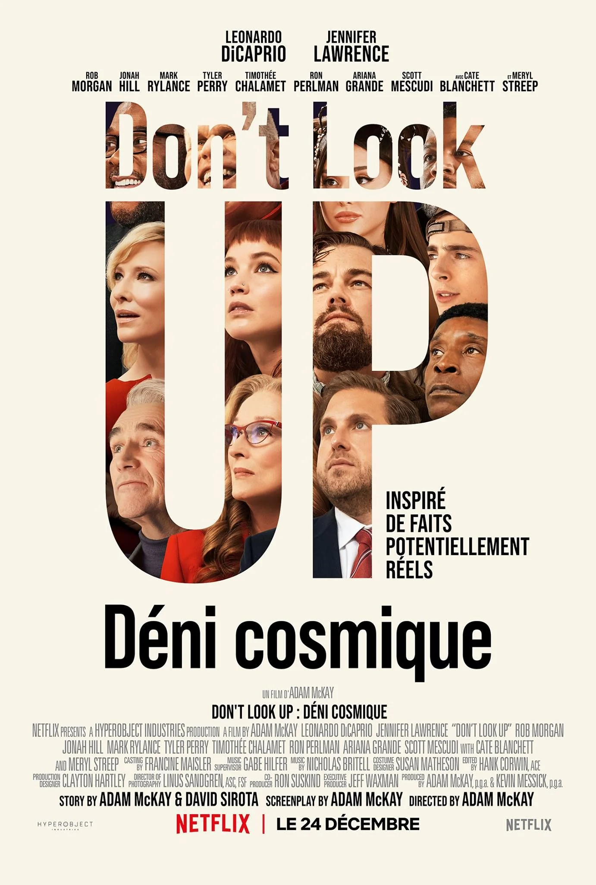

Ce billet de blog reprend essentiellement des ressentis et des réflexions menées en septembre 2026. Cependant, la durée de vie et la véracité des propos tenus ici doivent être remises dans leur contexte car le monde "IA" change très rapidement.

Les vérités de 2025 ne sont plus celles de 2026 et la vitesse de ces changements ne fait qu'augmenter. En attendant une probable stabilisation, la situation contribue à un écosystème qui se questionne.

## Pourquoi ce billet existe

Depuis longtemps je participe à des conférences de Hacking. Les sujets ont évolué au long des années et chacun peut se souvenir des thématiques générales. Certains évènements sont spécialisés sur certaines d'entre elles.

En 2026 toutes les conférences ont un thème commun, l'IA. D'une manière ou d'une autre la plupart des sujets proposés sont concernés. Et cela est assez dérangeant. Car au travers de leurs démonstrations techniques, j'ai pu observer des présentateurs qui se demandent souvent ce qu'ils deviendront.

## L'IA est un problème

### Des changements dans nos habitudes

L'ambiance dans le monde de la cyber a changé depuis l'avènement des LLM. Et ce changement est assez paradoxal car nous avons construit et nourri ce changement au fil des années. Cette participation a pris différents mécanismes. Nous avons par exemple construit des outils d'automatisation, des bases de connaissances complètes. De plus, depuis que la science-fiction existe, l'idée d'une véritable intelligence "non humaine" est présente.

Alors pourquoi est-ce un problème ? De nombreuses révolutions technologiques ont eu lieu pendant des années, l'informatique et internet en font partie. Avec l'IA nous prenons conscience que de nombreuses choses que nous faisons pourraient être faites par un agent. C'est ainsi toute une génération d'ingénieurs à qui a été promis "du travail pour toute une vie" qui se retrouve avec la crainte de perdre son travail. C'est une peur, pas une réalité même si la presse relate souvent des cas de licenciement "remplacés par de l'IA".

Les mécanismes d'informations ont également évolué. Depuis les années 2010 et l'avènement des réseaux sociaux des voix s'élèvent pour dénoncer les risques de manipulation de l'information par ces derniers et les fameux "algorithmes". Et pourtant, aujourd'hui Gemini est devenu le moteur d'accès principal de Google et Wikipédia enregistre de moins en moins de visites.

[Article sur la baisse de fréquentation de Wikipedia](https://www.vietnam.vn/fr/wikipedia-mat-hon-1-ti-luot-truy-cap-vi-ai)

### Une création qui dérange

Impossible de considérer les capacités des LLM sans considérer les mécanismes qui ont été mis en place pour entrainer ces modèles. Le traitement des données par des employés sous-payés au Kenya qui ont demandé de meilleures conditions de travail et qui ont fini par le perdre au profit des Ghanéens sûrement moins regardants à ce moment-là. Des milliers de litres d'eau qu'utilise cette technologie pour fonctionner alors que le réchauffement climatique et ses conséquences sont de plus en plus visibles et irréversibles. A-t-on vraiment besoin de mettre de l'IA et de consommer ces ressources à tout bout de champ ?

[Article sur le traitement des employés au Kenya](https://www.france24.com/fr/%C3%A9co-tech/20230120-chatgpt-sama-l-entreprise-%C3%A9thique-derri%C3%A8re-les-scandales-de-mod%C3%A9ration-au-kenya)

Pour nourrir les modèles d'IA, une entreprise comme Anthropic a acheté de nombreux livres anciens et les a détruits dans le but de les numériser. L'objet livre n'existe plus. Le contenu est stocké dans des bases de données. Qu'en est-il de son intégrité ? Quelle garantie que ce livre reste accessible ? Cette question nous nous la posons déjà lorsqu'un média disparait d'une plateforme de streaming.

Enfin, au cœur de ce que je considère être un problème il y a tous les cas d'utilisation "Pour faire de l'IA", je m'explique. Les entreprises actuelles subissent un stress important sur les marchés. L'IA est devenue un _game changer_, un critère pour démontrer aux autres l'avance technologique dans un monde ultra-concurrentiel.

_Je fais de l'IA, donc je suis à jour sur les technologies._ Oui, et toute votre stack technique qui repose sur des technologies obsolètes ?

Et puis il y a toutes les décisions qui ont été déléguées à un modèle sur la base de "tiens prends ce sondage et dis-moi ce que je dois en conclure". La morale est plus que discutable. Les réunions sont à présent entièrement résumées par IA, alors à quoi bon écouter ?

Cette section pourrait s'agrandir continuellement tant les preuves d'utilisation "pour utiliser" sont présentes. Mais est-il possible d'esquiver les fameuses affiches qui en 2026 ont déferlé dans notre quotidien ? L'IA ce n'est pas une simple histoire de logiciel d'entreprise, c'est la vie quotidienne. De nombreux évènements en 2026 ont utilisé des affiches générées par IA. Les restaurants s'y mettent aussi et c'est toute une économie, celle du design et de la création qui vacille. Des logiciels comme Canva proposaient déjà une "simplification" du processus créatif, ici le seul processus réside dans l'écriture de prompts. Peut-on encore parler de "création" ? Je préfèrerais ici, répétition et adaptation.

- [Article Radiofrance](https://www.radiofrance.fr/franceculture/affiches-generees-par-ia-pourquoi-elles-se-ressemblent-toutes-4380556)
- [Article Etapes](https://www.etapes.com/2026/06/26/le-piege-des-affiches-generees-par-ia/)

Résultat, un appauvrissement du visuel, tout se ressemble et cela respire le faux.
Si vous n'avez pas lu 1984, je vous invite a minima à lire cet article sur le [Novlangue](https://fr.wikipedia.org/wiki/Novlangue#Principes)

## L'IA est une opportunité

Notre réseau social d'entreprise préféré (LinkedIn) est rempli de messages qui vont dans ce sens. Entre les publicités et les posts décrivant des solutions incroyables apportées par l'IA difficile de croire que tout ce qui est apporté par celle-ci n'est que problématique.

Bien sûr, il est possible de penser aux avancées rapides et spectaculaires dans des domaines importants comme les mathématiques, en attendant (à date de l'écriture de ce billet) que l'IA permette de réaliser des progrès en médecine. La prochaine pandémie "de type COVID" prendra-t-elle autant de temps à être contrée avec ces capacités de calcul ?

Voitures autonomes, robotique, réalisation de tâches "ingrates", de métiers "difficiles". L'IA arrive dans notre monde avec la promesse de résoudre ces difficultés.

Le gain de temps sur de nombreuses tâches est indiscutable, notamment en développement. Et il faut reconnaitre que pour faire du code rapide qui répond à un besoin assez précis c'est imbattable. Avec les LLM j'ai pu créer des outils et des LAB très rapidement et me concentrer sur ce qui avait vraiment un intérêt pour moi à ce moment-là.

## Les cas de conscience

Prenons un exemple en lien avec la thématique de ce blog. Lors de tests d'intrusion il m'arrive souvent d'utiliser des outils qui ne correspondent pas à 100% à mon besoin. Certains pentester s'en accommodent, d'autres vont modifier le code et proposer des _pull request_ afin d'améliorer les outils.

Cependant avec les capacités de développement rapide offertes par tout LLM grand public il est possible de "créer son propre outil rapidement". Résultat, il est plus simple de faire coder un outil "jettable" plutôt que de chercher un outil existant, ou d'en modifier un qui correspondait "à peu près".

Autre exemple, lorsque j'étais étudiant j'ai décidé de souffrir et d'apprendre à utiliser _sed et awk_ . Aujourd'hui, je peux simplement demander à un LLM de faire ce travail à ma place, mais finalement pour quel gain ? **Tout ce gaspillage de ressources vaut-il ma flemme de réfléchir** ?

J'ai cité plus haut l'exemple des avancées dans les mathématiques, mais à quel prix ? Toute une génération de chercheurs qui ne sera pas, et une autre qui se retrouve coiffée au poteau par un programme qui a pu réunir les capacités de financements qu'ils demandaient depuis des années.

Et puis, une n-ième image détournée de votre collègue générée automatiquement vaut-elle vraiment les litres d'eau consommées pour refroidir les datacenters qui l'ont produite ? Le débat peut également s'étendre au stockage j'en conviens.

Enfin, les données récoltées lors de nos échanges avec ces modèles. Déjà que faire confiance à [Google](https://www.lemonde.fr/pixels/article/2025/09/04/google-condamne-aux-etats-unis-a-payer-425-7-millions-de-dollars-pour-atteinte-a-la-vie-privee_6638851_4408996.html) ou [Facebook](https://www.liberation.fr/international/amerique/affaire-cambridge-analytica-meta-condamne-a-payer-une-amende-record-de-25-milliards-de-dollars-au-nouveau-mexique-20261021_6J7JRSM3CVAFFB2FDLWAP4FUCM/) semblait impossible, QUID d'[OpenAI](https://siecledigital.fr/2026/09/27/des-images-personnelles-confiees-a-chatgpt-se-retrouvent-sur-internet/) et d'[Anthropic](https://www.generation-nt.com/actualites/claude-anthropic-arrestation-police-femme-floride-2082386) ?

Une réflexion sur "l'état des humains" est aussi à prendre en compte :

- https://www.reddit.com/r/AIDiscussion/comments/1wtydsu/considering_ai_made_your_work_faster_did_you_get/
- https://medium.com/write-a-catalyst/ai-saves-me-time-but-what-am-i-doing-with-the-time-it-gives-me-ffc1f0d42369
- https://www.linkedin.com/news/story/does-ai-give-you-time-back-or-just-raise-the-bar-7666628/

## Le monde de demain

L'avènement de l'IA a permis de mettre en évidence un monde qui change. Fini les gouvernements tout-puissants, place aux grandes entreprises. Difficile ici de ne pas faire de politique car à chaque fois que j'essaye de m'y restreindre elle revient sur le tapis. Les modèles d'IA ont besoin de données, ces données sont stockées et privatisées par des grands groupes. Quand j'ai démarré l'informatique le monde OpenSource semblait un refuge à l'hégémonie des GAFAM sur les technologies de l'information.

Avec l'IA même ces entreprises qui semblaient intouchables ont senti le vent tourner.

Ces outils sont dans notre présent, et il y a un avant / après. Je pense que nous vivons une révolution et que comme tout changement qu'elles entrainent de grands chamboulements sont présents. Et il faut nous adapter, mais sans renier les combats que nous menions. Ainsi, je pense que l'IA est largement acceptable et qu'elle devrait être utilisée à bon escient, que les peuples devraient être maîtres de leur avenir et décider des combats prioritaires, et non se laisser guider par des choix financiers d'entreprises. Nos enfants vivront dans un monde où l'information n'est pas celle que nous avons connue (cela dit, nous vivons dans un monde que nos parents n'ont pas connu non plus).

Permettera-t-elle de construire un monde "meilleur" ? Mais qu'est-ce qu'"un monde meilleur" ? Car quand je regarde [Don't Look Up](https://www.imdb.com/title/tt11286314/) j'ai tendance à me dire "oui tout cela est possible".

En tout cas l'ère de l'IA est bien présente et nous vivrons avec, à nous de décider ce qu'elle deviendra. Les enjeux de souveraineté des données deviennent de plus en plus forts, et c'est une sorte de "guerre froide de l'information" qui s'est mise en place. Chaque pays s'arme d'une IA ou s'en remet à d'autres.

Y aura-t-il des gagnants ? Ou une fois de plus notre planète sera-t-elle encore une fois la grande perdante ?

Tant de questions qui trouveront peut-être une réponse dans quelques années, qui sait, ce billet pourrait extrêmement mal vieillir. En tout cas j'espère ne pas avoir été trop pessimiste, ces réflexions me sont propres.
